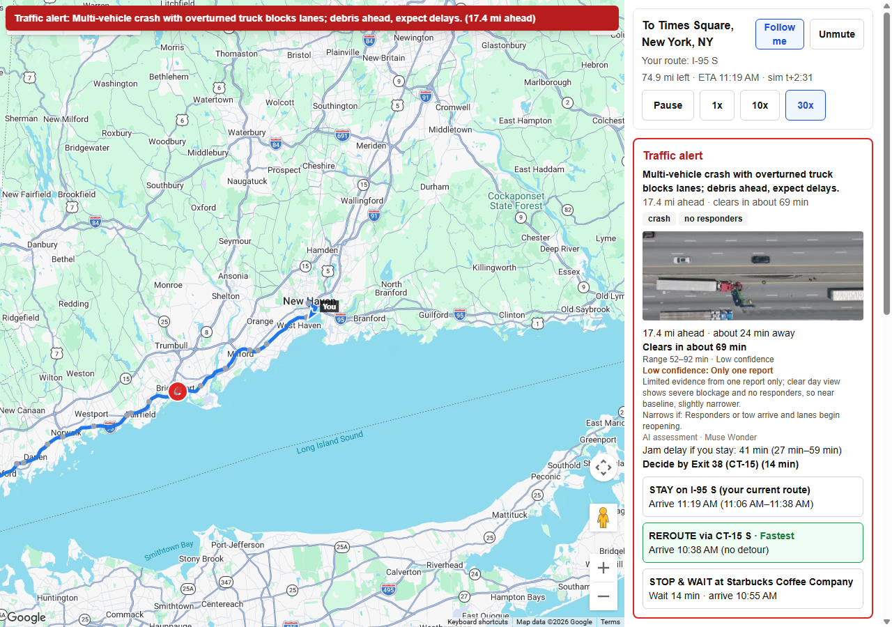
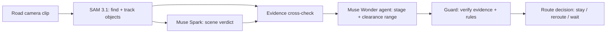

# Daari Sentinel

Road cameras — dashcams in cars and roadside traffic cameras — become an early incident warning: cameras see the crash, and drivers behind get a stay / reroute / wait decision before they reach it.

**Live demo: [https://daari-sentinel.vercel.app](https://daari-sentinel.vercel.app)** · **Try your own clip: [daari-sentinel.vercel.app/try](https://daari-sentinel.vercel.app/try)**



## What it does

- Watches road-camera clips (dashcams in cars and roadside traffic cameras) and detects road incidents: crashes, emergency vehicles, debris, road work.
- Cross-checks every AI claim against tracked objects, so the evidence is visible, not a black box.
- Predicts how long until the road clears, as an honest range that narrows as more cameras pass.
- Warns the driver ahead of the scene with three scored options: stay, reroute, or stop and wait.
- Respects the driver's choice across multiple incidents: no flip-flopping, and an offer to return when the road clears.

## How it works



1. **SAM 3.1** finds and tracks objects in the clip (cars, responders, cones, people) and counts them.
2. **Muse Spark** reads the scene and returns a structured verdict: incident type, severity, responders, evidence timestamps.
3. The **cross-check** matches each verdict claim against the SAM tracks (supported / unverified / conflict).
4. The **Muse Wonder agent** tracks the incident across camera reports and returns its stage plus a clearance range.
5. The **guard** verifies the agent's evidence, enforces range rules, and falls back to planning defaults when unsure.
6. The **route engine** scores stay / reroute / stop-and-wait against the clearance range and the driver's active plan.

Faces and license plates are blurred in every image and video shown, including user uploads.

## Meta models and their jobs

| Model | Job |
| ---- | --- |
| SAM 3.1 (`sam-3.1`) | Find and track objects; true counts from stills; blur faces and plates |
| Muse Spark 1.3 (`muse-spark-1.3-contributor`) | Scene verdict: incident type, severity, responders, evidence |
| Muse Wonder (`muse-wonder-1.0`) | Incident agent: stage, clearance range, cited evidence, driver wording |
| Built with Muse Code | This repo was written with Muse Code |

Input $4.00 / cached $0.20 / output $20.00 per 1M tokens for Muse Wonder (2026-10-27);
SAM 3.1 bills per video frame ($0.20 per 1,000 frames, minimum 50 frames per request).
Every real API call is appended to `data/ledger.jsonl`; uploads and results are cached
under `data/cache/` so repeat runs are free, and `data/snapshot/` ships the demo's
results so a fresh deploy replays at $0.

## Evaluation

Verdict accuracy on 19 labeled clips ([full report](data/eval/batch-report.md)):

- Incident detected: **19/19**, type right: **18/19**, responders right: **72/76**
- Zero false alarms on **8** normal-traffic clips

Camera view per eval clip (from the footage itself):

| View | Clips |
| ---- | ----- |
| Aerial (13) | crash-1, traffic-cars-1, traffic-cars-2, police-car-1, cars-with-police-1, crowd-people-1, car-tow-ambulance-police-1, rd-construction-1, policecars-1, policecars-2, car-traffic-3, road-work-2, road-work-3 |
| Traffic-cam (3) | traffic-cars-3, car-police-tow-1, ambulance-fire-1 |
| Dashcam (3) | traffic-normal-1, car-accident-1, dash-cam-car-1 |

Agent check (`npx tsx scripts/agent-check.ts`, 7/7 PASS):

- Stages never go backward across the 4-report demo sequence, ending `cleared`
- The clearance range narrows report by report: likely 72 → 36 → 10 min (55–95 → 27–46 → 6–15)
- A single night report gets `low` confidence and a wider range than a clear day report
- The guard keeps the stage from moving backward on conflicting reports and notes the conflict

Triage ladder (`npx tsx scripts/triage-eval.ts`, [full report](data/eval/batch-report.md)):

- Level 1 quick look (one still, cheap model): **16/19** — all 11 incident clips flagged, 3 normal clips over-flagged (crowd read as hazard, heavy traffic read as stopped)
- Verdict at low reasoning effort matches medium (incident 19/19, responders 72/76) and fixes one type call (19/19 vs 18/19), so `/try` verdicts run at low effort
- Cost per driving hour at 1 quick look/min: **$0.33** at a realistic 5% escalation rate (median quick look $0.0002, full check $0.11)

## Network effect

"Play network demo" on `/sim`: you drive New Haven → JFK, and as you pass
Norwalk your camera's quick look flags a crash — the same cached pipeline
results as the I-95 demo, so the scenario replays at $0. About 40 drivers on
10 committed corridor trips (routes responses precomputed into
`data/snapshot/network/`, nothing fetched at runtime) react to your report.
Each notified driver gets the same stay / reroute / wait scoring from their
own position, with seeded choices (75% fastest, 15% stay, 10% wait) and
detour load (+0.15 min per rerouting driver, capped at +8 min).

Verified numbers: your report reached **11 drivers — 4 rerouted, 6 stayed,
1 stopped to wait — saving an estimated 3.2 driver-hours**; 29 drivers were
not alerted (already past, going the other way, or arriving after it clears).
Northbound drivers are never notified, and you get no warning — you're
already past it — just a thanks for helping other drivers.

## How the clearance time is estimated

These are planning estimates, not learned from real clearance records:

1. Start from a **planning default** range for the incident type and stage
   (e.g. crash with no responders yet: about 55 min, range 40–75).
2. The **agent** adjusts from that baseline only with evidence it cites, and says
   what sighting would narrow the range next.
3. The **guard** enforces the rules: ordered ranges, width limits, no backward
   stages, responder claims need responder evidence — else it widens the range
   and says why.

The headline ("Clears in about 35 min") counts down as time passes; if the range
runs out with no "cleared" report, the card says so instead of declaring it clear.

## Compared with today's maps apps

| | Today's maps apps | Daari Sentinel |
| --- | --- | --- |
| Reporting | People tap to report | The camera sees it |
| Proof | None | Evidence frames you can play |
| Stage | Just "crash" | No responders → police → tow → cleared |
| Clearance | Inferred from traffic speed | Predicted from the scene, as a range |
| Removal | Votes and timers | A camera sees it clear |
| Decision | A faster route | Stay / reroute / wait, plus a decide-by exit |

## Honest limitations

- The demo uses stock footage as stand-ins for one incident across reports.
- Most incident footage in the demo is aerial or traffic-camera style stock video; dashcam-view footage covers normal traffic and work zones.
- SAM's video mode caps at 16 tracked objects per frame; we add uncapped still-frame counts for cars, trucks and people.
- Clearance calibration is planning defaults plus agent judgment, not fitted to real clearance records.
- This is a simulation with scripted camera passes, not a live fleet.

## Built during the hackathon

Meta Global AI Developer Hackathon, Oct 27 – Nov 4, 2026. All work below was
built during the hackathon window.

| Date   | What was built                              |
| ------ | ------------------------------------------- |
| Oct 27 | Project setup and SAM 3.1 perception lab    |
| Oct 27 | Verified: build, prep, cached analyze, overlay boxes, 390px layout (live SAM call pending a real API key) |
| Oct 27 | first live SAM 3.1 runs on real footage; concept list moved to plain objects, Muse Spark will judge incidents |
| Oct 27 | Muse Spark scene verdict with evidence cross-check (Day 2) |
| Oct 27 | footage set expanded to 19 clips with ground-truth labels and a first evaluation run |
| Oct 27 | I-95 live simulation with real AI incident reports (Day 3) |
| Oct 27 | driver experience — trip planning, advance warnings, stay/reroute/stop options (Day 3) |

Commit messages before this point say 'Day 1–3'; these were build steps, all completed on Oct 27, the first building day.

| Oct 27 | Step 4b: realistic jam delay, exit-based decide-by, named reroutes |
| Oct 27 | Step 4c: fix missing clip list on /sim |
| Oct 27 | Step 4d: fix map zoom with follow mode |
| Oct 27 | Step 5: Muse Wonder incident agent with verified evidence and honest ranges |
| Oct 27 | Step 6: calibrated clearance times, clickable evidence, instant reroute feedback |
| Oct 27 | Step 6b: active route plans, multiple incidents, no flip-flopping |
| Oct 28 | Step 7: privacy blur, demo snapshot, judge README |
| Oct 28 | Step 7b: road-camera wording, stop-and-wait fix |
| Oct 28 | Step 8a: Vercel deploy — clips on Blob, read-only production mode, Redis ledger |
| Oct 28 | Step 8b: landing page and try-your-own-clip with cost guards |
| Oct 29 | Step 8b fix: harden /try upload token route, surface server errors |
| Oct 29 | Step 8c: triage ladder, map-change rules, faster /try |
| Oct 29 | Step 8c fix: /try live calls bypass the snapshot gate safely |
| Oct 29 | Step 8d: blur faces and plates in /try results |
| Oct 29 | Step 8e: network demo — one camera report, many drivers; /try quota and owner pass |

## Run locally

Prerequisites: Windows + PowerShell, Node >= 22.9, `ffmpeg` on PATH
(e.g. `winget install Gyan.FFmpeg`).

```powershell
npm install
Copy-Item .env.example .env.local   # then put your real keys in .env.local
npm run dev
```

Open [http://localhost:3000/lab](http://localhost:3000/lab) for the perception lab,
[http://localhost:3000/sim](http://localhost:3000/sim) for the driving simulation,
or [http://localhost:3000/try](http://localhost:3000/try) to analyze your own clip
(needs `TRY_IT_ENABLED=true` plus the Blob/Redis keys).
The demo replays from the committed snapshot at $0; set `LIVE_CALLS=true` to allow
fresh API calls.

Production runs on Vercel in read-only mode: clips stream from Vercel Blob
(`NEXT_PUBLIC_CLIPS_SOURCE=blob`), caches read from `data/snapshot/` only, the
cost ledger lives in Upstash Redis, and `LIVE_CALLS_ENABLED=false` blocks all
live calls instantly. Required Vercel env vars: `NEXT_PUBLIC_CLIPS_SOURCE=blob`,
`NEXT_PUBLIC_GOOGLE_MAPS_BROWSER_KEY`, `GOOGLE_MAPS_SERVER_KEY`,
`BLOB_READ_WRITE_TOKEN`, `UPSTASH_REDIS_REST_URL`, `UPSTASH_REDIS_REST_TOKEN`.

## Footage credits

| Clip | Source URL | License |
| ---- | ---------- | ------- |
| crash-1.mp4 | https://www.pexels.com/video/aerial-shot-of-a-car-accident-on-a-highway-12753260/ | Pexels License |
| traffic-normal-1.mp4 | https://www.pexels.com/video/busy-urban-street-with-taxis-in-traffic-jam-36911808/ | Pexels License |
| traffic-cars-1.mp4 | https://www.pexels.com/video/an-aerial-view-of-a-busy-street-with-cars-and-people-19166351/ | Pexels License |
| traffic-cars-2.mp4 | https://www.pexels.com/video/an-aerial-view-of-a-city-street-with-cars-and-people-19166359/ | Pexels License |
| traffic-cars-3.mp4 | https://www.pexels.com/video/traffic-on-street-in-rush-hour-14552312/ | Pexels License |
| police-car-1.mp4 | https://www.pexels.com/video/aerial-nighttime-traffic-stop-with-police-lights-32538553/ | Pexels License |
| cars-with-police-1.mp4 | https://www.pexels.com/video/aerial-view-of-busy-atlanta-highway-at-night-33134648/ | Pexels License |
| car-police-tow-1.mp4 | https://pixabay.com/videos/car-accident-police-9781/ | Pixabay Content License |
| crowd-people-1.mp4 | https://www.pexels.com/video/bustling-street-market-aerial-view-35245798/ | Pexels License |
| car-tow-ambulance-police-1.mp4 | https://www.pexels.com/video/drone-footage-of-car-accident-at-an-intersection-4686100/ | Pexels License |
| car-accident-1.mp4 | https://www.pexels.com/video/17785830/ | Pexels License |
| dash-cam-car-1.mp4 | https://www.pexels.com/video/a-time-lapse-video-of-moving-cars-8996082/ | Pexels License |
| ambulance-fire-1.mp4 | https://www.pexels.com/video/a-fire-truck-and-police-vehicles-in-the-street-at-night-11387588/ | Pexels License |
| rd-construction-1.mp4 | https://www.pexels.com/video/moving-vehicles-on-a-highway-8597290/ | Pexels License |
| policecars-1.mp4 | https://www.pexels.com/video/aerial-view-of-police-operation-in-suburban-area-33930776/ | Pexels License |
| policecars-2.mp4 | https://www.pexels.com/video/aerial-view-of-police-activity-in-neighborhood-33930780/ | Pexels License |
| car-traffic-3.mp4 | https://www.pexels.com/video/an-aerial-view-of-a-highway-with-cars-on-it-19452742/ | Pexels License |
| road-work-2.mp4 | https://www.pexels.com/video/people-working-on-the-road-4430486/ | Pexels License |
| road-work-3.mp4 | https://www.pexels.com/video/a-road-with-construction-vehicles-and-traffic-cones-28001192/ | Pexels License |
